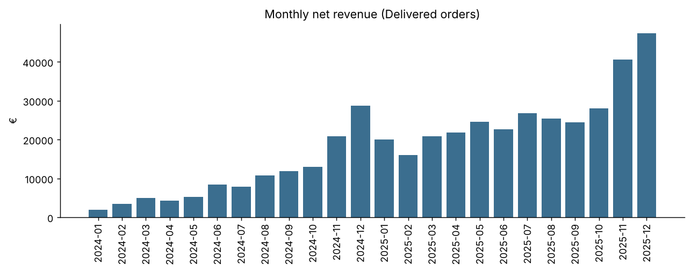
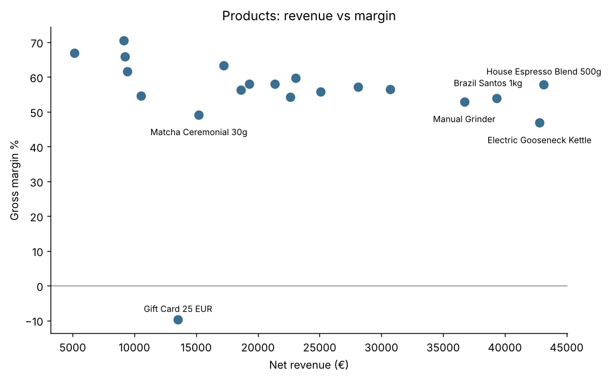
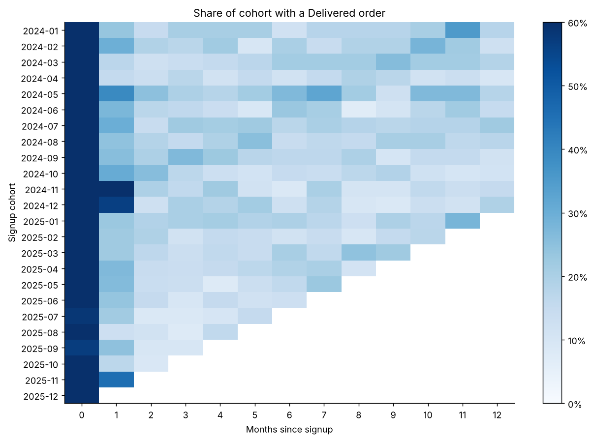
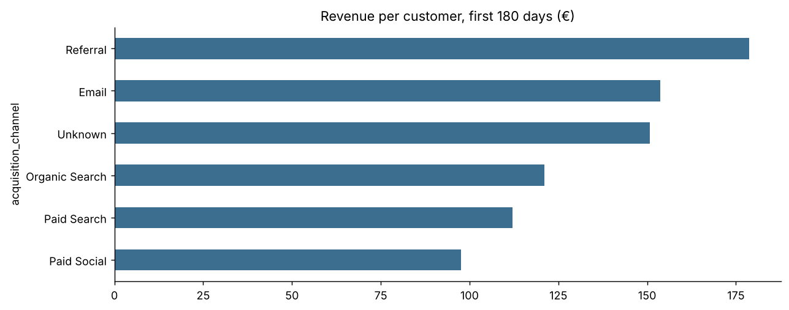

# ☕ Aegean Brew Co. — Customer & Sales Analysis

**Tools:** SQL (SQLite) · Python (pandas, matplotlib) · Jupyter

An end-to-end analysis for a fast-growing online coffee retailer: cleaning messy raw data, answering the founder's business questions, and turning the results into concrete recommendations.

👉 **[Full analysis notebook](notebooks/aegean_brew_analysis.ipynb)** · **[SQL exploration queries](sql/exploration_queries.sql)**

---

## The business question
Aegean Brew Co. sells specialty coffee, tea and brewing equipment online across Europe and has grown quickly since launching in January 2024. The founder asked:

1. Which products actually make us money?
2. Are customers coming back?
3. Is our Paid Social spending bringing in good customers?
4. How reliable is our data?

## Key findings

**1. Revenue grew ~160% year over year (€122k → €319k), almost entirely from more customers.** Average order value stayed flat at about €52–54. November and December bring in ~28% of annual revenue.



**2. Coffee beans are the profit engine. Discounted gift cards lose money.** Beans earn a steady ~56% margin and drive repeat purchases. The electric kettle is the #2 product by revenue but has the lowest margin of any physical product (~47%). Gift cards sold during promotions have a negative margin. An 8% price increase on beans in March 2025 did not visibly hurt volumes.



**3. Customers return, but slowly.** 61% of buyers place a second order. Only ~18% of a signup cohort is active in any given later month, so people buy every few months. About 1 in 8 signups never completes an order.



**4. Paid Social brings the lowest-value customers.** In their first 180 days, Referral customers spend €179 and Email customers €154, compared with €98 for Paid Social. Paid Social customers also repeat less (50% vs 79% for Referral).



**5. A quarter of customers drive over half of revenue.** RFM segmentation shows "Champions" are 25% of buyers and 56% of revenue. A further 15% are "At Risk": former regulars who haven't ordered in roughly 9 months.

## Recommendations
1. **Launch a coffee-bean subscription** (every 4–6 weeks) to turn slow repeat buyers into predictable revenue.
2. **Invest in referrals.** A give-€5/get-€5 scheme could be funded by moving part of the Paid Social budget, once channel costs confirm the trade-off.
3. **Plan Q4 from September.** Stock equipment and gift bundles early, run a win-back campaign for the ~320 At Risk customers, and stop discounting gift cards.

## Data cleaning
The raw data had several problems that would have distorted the results. I logged each issue and the decision taken:

| Issue | Rows | Decision |
|---|---|---|
| Duplicate customer records | 25 | Removed |
| Inconsistent country names (`GR`, `Deutschland`, casing, whitespace) | ~120 | Standardised to 8 countries |
| Mixed timestamp formats (ISO and DD/MM/YYYY) | 300 | Parsed each format explicitly; `pd.to_datetime` alone would have silently swapped day and month |
| Internal test orders (bulk equipment, no real customer) | 3 orders | Excluded |
| Duplicate order lines from a double data load | ~90 | Removed (would have added ~€2.5k of fake revenue) |
| Zero or negative quantities | ~25 | Removed; returns are tracked through order status |
| Placeholder birth years (1900) and missing channels | 6 / 60 | Set to unknown and reported separately |

## Methods
- **SQL:** joins, CTEs, `CASE WHEN`, window functions (`ROW_NUMBER`, `LAG`, running `SUM`), anti-joins to find orphan records.
- **pandas:** data-quality checks, merges validated with `validate="many_to_one"`, explicit date parsing, `groupby` and `pivot`.
- **Cohort retention:** customers grouped by signup month, with activity tracked across the following months.
- **Channel comparison:** limited to customers with a full 180 days of history so recent signups don't bias the result.
- **RFM segmentation:** recency, frequency and monetary value scored by quintile and combined into five segments.

## Limitations and next steps
- No marketing spend data, so customer acquisition cost (CAC) and channel ROI can't be calculated. Getting spend by channel is the top priority.
- No reason codes for cancellations and returns. Their ~17% rate is flat across countries, payment methods and categories.
- Gift-card sales are counted as revenue here; strictly they are a liability until redeemed.
- Next: market-basket analysis and a seasonal revenue forecast for 2026.

## Repository structure
```
├── data/                 raw CSVs + SQLite database (aegean_brew.db)
├── notebooks/            full analysis with outputs
├── sql/                  exploration queries with results
├── images/               charts used in this README
├── generate_data.py      script that generated the synthetic dataset
└── requirements.txt
```

## How to run
```bash
pip install -r requirements.txt
jupyter notebook notebooks/aegean_brew_analysis.ipynb
```
Run the SQL with `sqlite3 data/aegean_brew.db` or any SQLite client (DB Browser for SQLite, DBeaver).

---
*The dataset is synthetic, generated with deliberate data-quality issues to reflect real-world conditions. Aegean Brew Co. is fictional.*
